<p align="center">
  <picture>
    <source media="(prefers-color-scheme: dark)" srcset="docs/assets/banner-dark.webp">
    <source media="(prefers-color-scheme: light)" srcset="docs/assets/banner-light.webp">
    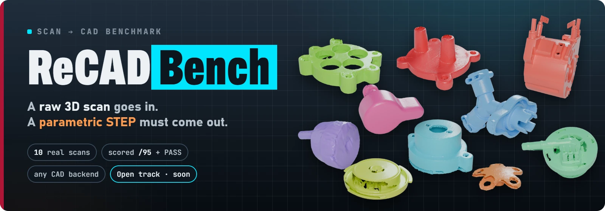
  </picture>
</p>

<p align="center">
  <a href="spec/"></a>
  <a href="spec/pyproject.toml"></a>
  <a href="#the-10-tasks"></a>
  <a href="#scoring"></a>
  <a href="#recadbench-open-coming-soon"></a>
</p>

<p align="center">
  <b>Scan → parametric CAD reverse-engineering benchmark for AI agents.</b><br>
  <a href="#what-we-measure">What we measure</a> ·
  <a href="#the-10-tasks">The 10 tasks</a> ·
  <a href="#scoring">Scoring</a> ·
  <a href="#recadbench-open-coming-soon">Take part</a> ·
  <a href="docs/architecture/README.md">Architecture</a> ·
  <a href="STATUS.md">Status</a>
</p>

---

An agent gets a **real 3D scan** (`input.stl`: raw, noisy, holed, in the scanner frame) and must produce a clean,
editable, **single-solid parametric model** that recovers design intent ([ADR 0002](docs/adr/0002-real-scan-input.md)).
Not a surface wrap, not a mesh-to-B-rep conversion: a feature tree that a human engineer could open and edit.

## What we measure

<p align="center">
  <picture>
    <source media="(prefers-color-scheme: dark)" srcset="docs/assets/flow-dark.webp">
    <source media="(prefers-color-scheme: light)" srcset="docs/assets/flow-light.webp">
    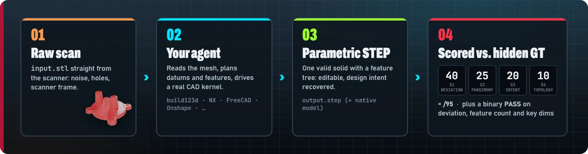
  </picture>
</p>

Three layers are evaluated separately, so a result says *which* layer made the difference:

| Layer | What it is | Where |
|---|---|---|
| **L1 · CAD backend** | pinned, external: build123d-mcp, `solidcraft-cli mcp`, a FreeCAD MCP, Siemens NX via journals | [`backends/`](backends/) |
| **L2 · CAD skillset** | how the agent drives the kernel (private `recadbench-cad-skills`) | Track T |
| **L3 · RE strategy** | how the agent reads a scan and plans features (private `recadbench-strategies`) | Track S / E |

## The 10 tasks

Five parts from our own scans of an **R385 12 V diaphragm pump**, five from the open-source **Open Dedica DIY espresso machine**.
The images are renders of the raw scans: exactly what the agent gets, with every hole and artefact.

<table>
  <tr>
    <td align="center" width="20%">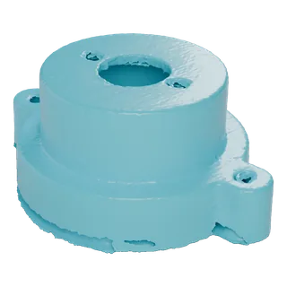<br><b>01 · Motor mount cup</b><br><sub><code>r385_hs01_motor_mount</code></sub><br><sub>🟢 medium</sub></td>
    <td align="center" width="20%">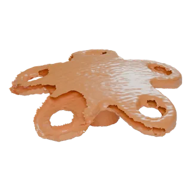<br><b>02 · Wobble plate</b><br><sub><code>r385_dr02_wobble_plate</code></sub><br><sub>🟠 hard</sub></td>
    <td align="center" width="20%">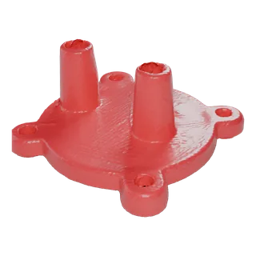<br><b>03 · Pump head</b><br><sub><code>r385_hs04_pump_head</code></sub><br><sub>🔴 very hard</sub></td>
    <td align="center" width="20%">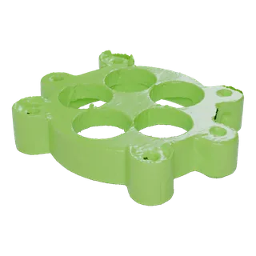<br><b>04 · Diaphragm frame</b><br><sub><code>r385_hs02_diaphragm_frame</code></sub><br><sub>🟠 hard</sub></td>
    <td align="center" width="20%">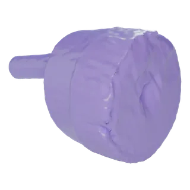<br><b>05 · Eccentric hub</b><br><sub><code>r385_dr01_eccentric_hub</code></sub><br><sub>🟢 medium</sub></td>
  </tr>
  <tr>
    <td align="center">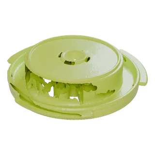<br><b>06 · Brewing gasket support</b><br><sub><code>od_g04_brewing_gasket_support</code></sub><br><sub>🟢 medium</sub></td>
    <td align="center"><br><b>07 · Steam knob</b><br><sub><code>od_s03_steam_knob</code></sub><br><sub>🟢 medium</sub></td>
    <td align="center">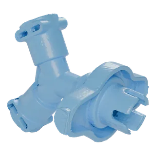<br><b>08 · 3-way valve</b><br><sub><code>od_h22_three_way_valve</code></sub><br><sub>🟠 hard</sub></td>
    <td align="center">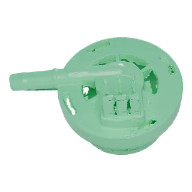<br><b>09 · Flowmeter</b><br><sub><code>od_h24_flowmeter</code></sub><br><sub>🔴 very hard</sub></td>
    <td align="center">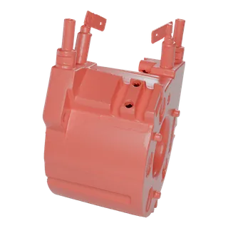<br><b>10 · Thermoblock</b><br><sub><code>od_h11_thermoblock</code></sub><br><sub>🔴 very hard</sub></td>
  </tr>
  <tr>
    <td colspan="5" align="center"><sub>01–05 · R385 diaphragm pump &nbsp;|&nbsp; 06–10 · Open Dedica espresso machine &nbsp;|&nbsp; ground truth is never published</sub></td>
  </tr>
</table>

## Scoring

Every submission is a STEP file in the scanner frame. The evaluator registers it to the hidden ground truth and scores
four components. A gate comes first: the STEP must load as exactly **one valid, closed solid**, must not be a faceted
mesh-to-B-rep conversion, and must be a real parametric body. Fail the gate and every score is 0.

| | Component | Points | What it rewards |
|---|---|:-:|---|
| **S1** | Deviation | **40** | two-way surface distance to the GT B-rep, inside class tolerance bands (observable region only) |
| **S2** | Parsimony | **25** | a feature count close to the reference; LEGO-style stacks of hundreds of features score 0 |
| **S3** | Design intent | **20** | key dimensions within tolerance, standard values, coaxial and symmetric relations kept |
| **S4** | Topology | **10** | matching through-hole count and face-type mix (planes, cylinders, cones, …) |
| | **Total** | **/95** | S5 editability (+5) is enabled later |

> **PASS** (binary: the part has one right answer) ⇔ gate passed **∧** S1 tolerance targets met **∧** feature ratio
> `0.5 ≤ r ≤ 1.5` **∧** ≥ 80 % of key dimensions within class tolerance.

Full rubric, tolerance classes and statistics: [`docs/architecture/03_SCORING.md`](docs/architecture/03_SCORING.md).

## ReCADBench Open: coming soon

Run **your own agent** on 10 real scans and upload the result: an online leaderboard in the style of Hugging Face's
CADGenBench (a Space with Submit / Leaderboard / Tasks, a public inputs dataset, private ground truth).
Announced live on 2026-11-18; the submission Space opens in the coming days. Design: [ADR 0006](docs/adr/0006-open-track.md)
(proposed).

**How to take part**

1. Download the 10 scans (`input.stl` + `task.yaml` per task) from the public inputs dataset (link follows).
2. Let your agent, with any CAD backend (build123d, NX, FreeCAD, SolidWorks, Onshape, ...), rebuild each scan as one
   parametric solid in the scanner frame.
3. Zip `meta.json` + one folder per task with `output.step` (optionally the native model, plan and run stats) and
   upload it in the Space. Format: [docs/benchmark/submission.md](docs/benchmark/submission.md) (draft).
4. Every upload gets an automatic **Open** score (/95, STEP-only). Submissions with a native model can be
   **Verified** by an admin, which adds the official feature-tree score (S2) and PASS.

Ground truth is never published. These 10 tasks are a public dev set; a hidden test set follows later.

## Repositories

| Repo | Visibility | Contents |
|---|---|---|
| `ReCADBench` (this) | public | contracts (`spec/`), backend pins + adapters, dataset *tooling*, evaluator, runner, orchestrator, leaderboard |
| `recadbench-cad-skills` | private | L2 skillsets per backend |
| `recadbench-strategies` | private | L3 strategies A–D + oracle, RE toolkit `retk` |
| `recadbench-data` | private | agent-visible inputs: `parts/<id>/{input.stl, task.yaml}`, splits |
| `recadbench-gt` | private | ground truth — evaluator host only |

No part data or ground truth is ever committed here: CI runs `dataset/tools/check_public.py`, which
rejects `*.stl`, `*.step`, `*.stp`, `*.prt` outside `backends/conformance/` and `evaluator/golden/`
(synthetic fixtures only) and any `gt_plan.json` / `key_dims.yaml` / `gt.step` / `gt_native.*` file.

## Layout

```
spec/          recadbench-spec: JSON Schemas, feature taxonomy (contract source of truth)
backends/      L1 pins + adapters (build123d, solidcraft, freecad, nx) + conformance suite
dataset/tools/ make_task.py (GT → inputs), check_public.py (CI guard)
evaluator/     recadbench-eval
runner/        recadbench-run: compose, gate_hook, agent backends, finish
orchestrator/  experiments, queue, worker
results/       gitignored (synced to Drive)
leaderboard/   build.py
docs/          architecture, ADRs, benchmark submission format, setup
```

## Development

Python ≥ 3.11, per-package `pyproject.toml` (`spec/`, `evaluator/`, `runner/`).

```bash
pip install ruff pytest -e ./spec -e ./evaluator -e ./runner
ruff check . && pytest && python dataset/tools/check_public.py
```

Host setup, fine-grained access tokens for workers and the evaluator host, and private-repo clones:
[`docs/SETUP.md`](docs/SETUP.md).

> Status: P1 scaffold + P2 spec (`recadbench-spec` 0.3.0, [ADR 0004](docs/adr/0004-spec-030-known-gaps.md)).
> v1 data = scan-rebuild parts, **dev-only** (no frozen test split yet). Progress: [`STATUS.md`](STATUS.md).

## Citation

```bibtex
@misc{recadbench2026,
  title        = {ReCADBench: A Scan-to-Parametric-CAD Reverse-Engineering Benchmark for AI Agents},
  year         = {2026},
  howpublished = {\url{https://github.com/mikbalarikan/ReCADBench}},
  note         = {spec 0.3.0}
}
```
